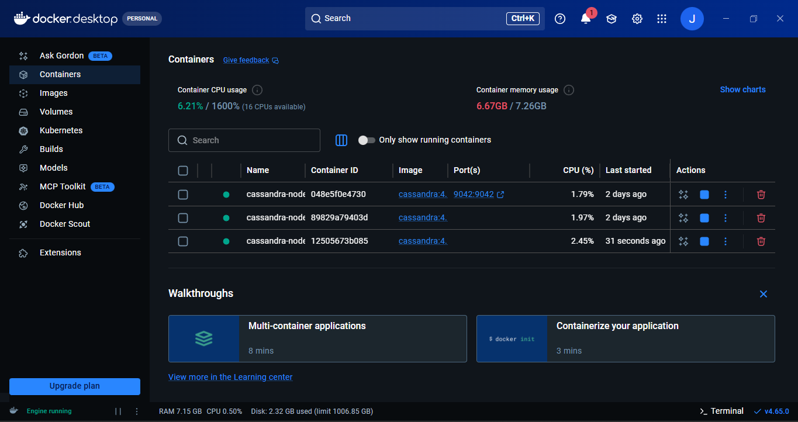
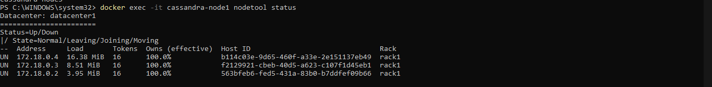
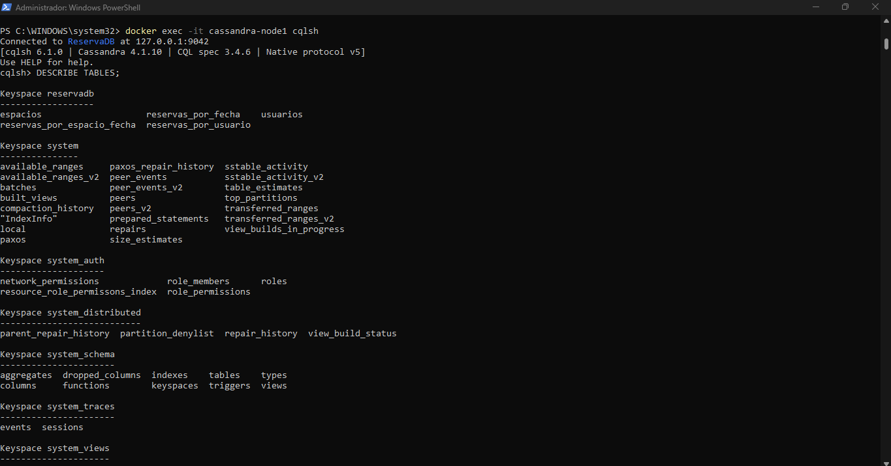
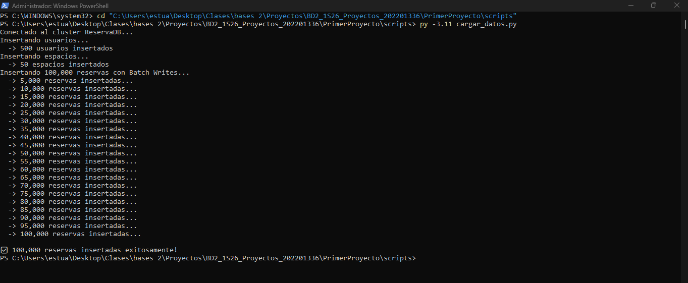

# ReservaDB — Manual de Usuario
## Sistema Distribuido de Gestión de Espacios Compartidos

---

**Universidad San Carlos de Guatemala**  
**Facultad de Ingeniería — Ingeniería en Ciencias y Sistemas**  
**Curso:** Sistemas de Bases de Datos 2  
**Proyecto:** Primer Proyecto — 1S 2026  
**Carnet:** 202201336  

---

## Índice

1. [Requisitos del Sistema](#1-requisitos-del-sistema)
2. [Guía de Instalación del Clúster](#2-guía-de-instalación-del-clúster)
3. [Estructura del Proyecto](#3-estructura-del-proyecto)
4. [Carga de Datos](#4-carga-de-datos)
5. [Consultas CQL Implementadas](#5-consultas-cql-implementadas)
6. [Gestión del Clúster](#6-gestión-del-clúster)
7. [Resolución de Problemas Comunes](#7-resolución-de-problemas-comunes)
8. [Referencia Rápida de Comandos](#8-referencia-rápida-de-comandos)

---

## 1. Requisitos del Sistema

Antes de instalar y usar ReservaDB, asegurate de tener lo siguiente:

### 1.1 Software requerido

| Software | Versión mínima | Descarga |
|---|---|---|
| Docker Desktop | 4.x o superior | https://www.docker.com/products/docker-desktop |
| Python | 3.11 | https://www.python.org/downloads/release/python-3119/ |

### 1.2 Librerías Python

```bash
py -3.11 -m pip install cassandra-driver faker
```

### 1.3 Recursos de hardware recomendados

| Recurso | Mínimo | Recomendado |
|---|---|---|
| RAM | 8 GB | 16 GB |
| Disco | 10 GB libres | 20 GB libres |
| CPU | 4 núcleos | 8 núcleos |

> ⚠️ **Importante:** Docker Desktop debe estar activo (ícono de ballena verde en la barra de tareas) antes de ejecutar cualquier comando.

---

## 2. Guía de Instalación del Clúster

### Paso 1 — Instalar Docker Desktop

1. Descargá Docker Desktop desde: https://www.docker.com/products/docker-desktop
2. Ejecutá el instalador y seguí los pasos (siguiente → siguiente → finish)
3. Reiniciá la PC si se solicita
4. Abrí Docker Desktop y esperá a que el ícono de la ballena esté **verde**



Si Docker te pide instalar **WSL 2**, aceptá. Es un componente necesario en Windows.

---

### Paso 2 — Crear la red Docker

Abrí PowerShell como administrador y ejecutá:

```bash
docker network create cassandra-net
```

**Resultado esperado:**
```
a1b2c3d4e5f6...  (ID de la red creada)
```

---

### Paso 3 — Levantar los 3 nodos de Cassandra

Ejecutá estos comandos **uno por uno**, esperando 30-40 segundos entre cada uno:

**Nodo 1 (seed node):**
```bash
docker run -d --name cassandra-node1 \
  --network cassandra-net \
  -e CASSANDRA_CLUSTER_NAME=ReservaDB \
  -e CASSANDRA_ENDPOINT_SNITCH=SimpleSnitch \
  -p 9042:9042 \
  cassandra:4.1
```

> ⏳ Esperá 30-40 segundos antes de continuar

**Nodo 2:**
```bash
docker run -d --name cassandra-node2 \
  --network cassandra-net \
  -e CASSANDRA_CLUSTER_NAME=ReservaDB \
  -e CASSANDRA_SEEDS=cassandra-node1 \
  -e CASSANDRA_ENDPOINT_SNITCH=SimpleSnitch \
  cassandra:4.1
```

> ⏳ Esperá 30-40 segundos antes de continuar

**Nodo 3:**
```bash
docker run -d --name cassandra-node3 \
  --network cassandra-net \
  -e CASSANDRA_CLUSTER_NAME=ReservaDB \
  -e CASSANDRA_SEEDS=cassandra-node1 \
  -e CASSANDRA_ENDPOINT_SNITCH=SimpleSnitch \
  cassandra:4.1
```

---

### Paso 4 — Verificar el clúster

Después de 1-2 minutos ejecutá:

```bash
docker exec -it cassandra-node1 nodetool status
```

**Resultado esperado:**
```
Datacenter: datacenter1
=======================
Status=Up/Down
|/ State=Normal/Leaving/Joining/Moving
--  Address     Load        Tokens  Owns   Host ID   Rack
UN  172.18.0.4  16.38 MiB  16      100%   ...       rack1
UN  172.18.0.3   8.51 MiB  16      100%   ...       rack1
UN  172.18.0.2   3.95 MiB  16      100%   ...       rack1
```

> ✅ **UN = Up/Normal** — los 3 nodos están activos y en el clúster.


---

### Paso 5 — Crear el Keyspace y las tablas

Entrá al cliente CQL:

```bash
docker exec -it cassandra-node1 cqlsh
```

Creá el keyspace:

```sql
CREATE KEYSPACE IF NOT EXISTS reservadb
WITH replication = {
  'class': 'SimpleStrategy',
  'replication_factor': 3
}
AND durable_writes = true;

USE reservadb;
```

Luego ejecutá el contenido completo del archivo `scripts/ddl.cql` para crear las 5 tablas.

Verificá que se crearon correctamente:

```sql
DESCRIBE TABLES;
```

**Resultado esperado:**
```
espacios                    reservas_por_fecha    usuarios
reservas_por_espacio_fecha  reservas_por_usuario
```



---

### Paso 6 — Salir de cqlsh

```sql
EXIT;
```

---

## 3. Estructura del Proyecto

```
BD2_1S26_Proyectos_202201336/
└── Primer Proyecto/
    ├── scripts/
    │   ├── ddl.cql              ← Definición del keyspace y tablas
    │   ├── consultas.cql        ← Consultas CQL del negocio
    │   ├── cargar_datos.py      ← Script carga masiva 100,000 reservas
    │   └── pruebas_fallos.py    ← Script pruebas tolerancia a fallos
    ├── docs/
    │   ├── Documentacion_Tecnica.pdf
    │   └── Manual_Usuario.pdf
    └── README.md
```

---

## 4. Carga de Datos

### 4.1 Ejecutar el script de carga masiva

Navegá a la carpeta `scripts` y ejecutá:

```bash
cd "ruta\a\tu\proyecto\scripts"
py -3.11 cargar_datos.py
```

**Progreso esperado:**
```
Conectado al cluster ReservaDB...
Insertando usuarios...
  -> 500 usuarios insertados
Insertando espacios...
  -> 50 espacios insertados
Insertando 100,000 reservas con Batch Writes...
  -> 5,000 reservas insertadas...
  -> 10,000 reservas insertadas...
  ...
  -> 100,000 reservas insertadas...
100,000 reservas insertadas exitosamente!
```

> ⏳ El proceso tarda aproximadamente 5-10 minutos dependiendo del hardware.



### 4.2 Verificar la carga

```bash
docker exec -it cassandra-node1 nodetool tablestats reservadb
```

Resultado de distribución confirmado:

| Tabla | Particiones | Escrituras |
|---|---|---|
| usuarios | 499 | 500 |
| espacios | 49 | 50 |
| reservas_por_espacio_fecha | 18,236 | 99,861 |
| reservas_por_usuario | 1,000 | 95,327 |
| reservas_por_fecha | 365 | 93,550 |

---

## 5. Consultas CQL Implementadas

Para ejecutar las consultas, entrá a cqlsh:

```bash
docker exec -it cassandra-node1 cqlsh
USE reservadb;
```

---

### Q1 — Consultar disponibilidad de un espacio en una fecha

**Descripción:** Devuelve todas las reservas de un espacio específico en una fecha determinada. Permite verificar qué horarios están ocupados y cuáles están disponibles.

**Sintaxis:**
```sql
SELECT hora_inicio, hora_fin, nombre_reserva, usuario_id, estado
FROM reservas_por_espacio_fecha
WHERE espacio_id = <uuid_espacio>
AND fecha = '<fecha>';
```

**Parámetros:**
| Parámetro | Tipo | Ejemplo |
|---|---|---|
| espacio_id | UUID | 535b89d4-4adb-4c91-81ef-3457be5d72cb |
| fecha | DATE (YYYY-MM-DD) | '2025-07-24' |

**Ejemplo práctico:**
```sql
SELECT hora_inicio, hora_fin, nombre_reserva, usuario_id, estado
FROM reservas_por_espacio_fecha
WHERE espacio_id = 535b89d4-4adb-4c91-81ef-3457be5d72cb
AND fecha = '2025-07-24';
```

**Resultado esperado:**
```
 hora_inicio         | hora_fin            | nombre_reserva  | usuario_id | estado
---------------------+---------------------+-----------------+------------+------------
 07:00:00.000000000  | 09:00:00.000000000  | Reserva Sala A  | uuid...    | confirmada
 09:00:00.000000000  | 11:00:00.000000000  | Reserva Sala B  | uuid...    | pendiente
 14:00:00.000000000  | 17:00:00.000000000  | Reserva Sala C  | uuid...    | confirmada
```


**Tabla utilizada:** `reservas_por_espacio_fecha`  
**Por qué es eficiente:** La Partition Key compuesta `(espacio_id, fecha)` garantiza acceso directo sin ALLOW FILTERING.

---

### Q2 — Ver historial de reservas de un usuario

**Descripción:** Devuelve todas las reservas realizadas por un usuario específico, ordenadas cronológicamente por fecha y hora de inicio.

**Sintaxis:**
```sql
SELECT fecha, hora_inicio, hora_fin, espacio_id, nombre_reserva, estado
FROM reservas_por_usuario
WHERE usuario_id = <uuid_usuario>;
```

**Parámetros:**
| Parámetro | Tipo | Ejemplo |
|---|---|---|
| usuario_id | UUID | 18439029-3649-4749-afe0-fd2f540ce555 |

**Ejemplo práctico:**
```sql
SELECT fecha, hora_inicio, hora_fin, espacio_id, nombre_reserva, estado
FROM reservas_por_usuario
WHERE usuario_id = 18439029-3649-4749-afe0-fd2f540ce555;
```

**Resultado esperado:**
```
 fecha      | hora_inicio         | hora_fin            | espacio_id | nombre_reserva | estado
------------+---------------------+---------------------+------------+----------------+------------
 2025-01-01 | 09:00:00.000000000  | 12:00:00.000000000  | uuid...    | Reserva Voy    | pendiente
 2025-01-01 | 17:00:00.000000000  | 20:00:00.000000000  | uuid...    | Reserva Falta  | pendiente
 2025-01-02 | 15:00:00.000000000  | 18:00:00.000000000  | uuid...    | Reserva Países | confirmada
```


**Tabla utilizada:** `reservas_por_usuario`  
**Por qué es eficiente:** La Partition Key `usuario_id` agrupa todas las reservas del usuario en una sola partición, permitiendo recuperar el historial completo con una única lectura.

---

### Q3 — Obtener ocupación de espacios en un rango de fechas

**Descripción:** Devuelve todas las reservas realizadas en un período de tiempo determinado. Útil para análisis de ocupación mensual o semanal.

**Sintaxis:**
```sql
SELECT fecha, hora_inicio, espacio_id, nombre_reserva, usuario_id, estado
FROM reservas_por_fecha
WHERE fecha >= '<fecha_inicio>'
AND fecha <= '<fecha_fin>';
```

**Parámetros:**
| Parámetro | Tipo | Ejemplo |
|---|---|---|
| fecha_inicio | DATE (YYYY-MM-DD) | '2025-07-01' |
| fecha_fin | DATE (YYYY-MM-DD) | '2025-07-31' |

**Ejemplo práctico:**
```sql
SELECT fecha, hora_inicio, espacio_id, nombre_reserva, usuario_id, estado
FROM reservas_por_fecha
WHERE fecha >= '2025-07-01'
AND fecha <= '2025-07-31';
```

**Resultado esperado:**
```
 fecha      | hora_inicio         | espacio_id | nombre_reserva   | usuario_id | estado
------------+---------------------+------------+------------------+------------+------------
 2025-07-01 | 07:00:00.000000000  | uuid...    | Reserva Especial | uuid...    | confirmada
 2025-07-01 | 08:00:00.000000000  | uuid...    | Reserva Natural  | uuid...    | cancelada
 2025-07-02 | 09:00:00.000000000  | uuid...    | Reserva Apoyo    | uuid...    | pendiente
```


**Tabla utilizada:** `reservas_por_fecha`  
**Por qué es eficiente:** La Partition Key `fecha` permite range scan eficiente. Cada día es una partición independiente.

---

## 6. Gestión del Clúster

### 6.1 Verificar estado del clúster

```bash
docker exec -it cassandra-node1 nodetool status
```

Los nodos deben mostrar **UN (Up/Normal)**.

### 6.2 Iniciar el clúster (si está apagado)

```bash
docker start cassandra-node1
docker start cassandra-node2
docker start cassandra-node3
```

### 6.3 Detener el clúster

```bash
docker stop cassandra-node1
docker stop cassandra-node2
docker stop cassandra-node3
```

### 6.4 Simular caída de un nodo (prueba)

```bash
# Detener nodo 3
docker stop cassandra-node3

# Verificar que el clúster sigue funcionando con 2 nodos
docker exec -it cassandra-node1 nodetool status

# Restaurar nodo 3
docker start cassandra-node3
```

### 6.5 Ver logs de un nodo

```bash
docker logs cassandra-node1
docker logs cassandra-node2
docker logs cassandra-node3
```

### 6.6 Entrar al cliente CQL

```bash
docker exec -it cassandra-node1 cqlsh
```

### 6.7 Ver distribución de datos

```bash
docker exec -it cassandra-node1 nodetool tablestats reservadb
```

---

## 7. Resolución de Problemas Comunes

| Problema | Causa probable | Solución |
|---|---|---|
| `Cannot connect to any server` | Docker no está activo | Abrir Docker Desktop y esperar a que el ícono esté verde |
| `Connection refused` en puerto 9042 | Nodo 1 no levantado | Ejecutar `docker start cassandra-node1` |
| Timeout en `SELECT COUNT(*)` | Tabla muy grande para COUNT | Normal en Cassandra. Usar `LIMIT` o `nodetool tablestats` |
| `Cannot achieve consistency level ALL` | Un nodo está caído | Usar QUORUM en lugar de ALL, o reiniciar el nodo caído |
| Nodo en estado `DN` (Down) | Nodo detenido o crasheado | Ejecutar `docker start cassandra-nodeX` |
| Script Python no conecta | Puerto 9042 no expuesto | Verificar que node1 tiene `-p 9042:9042` en el run |
| `ModuleNotFoundError: cassandra` | Librería no instalada | Ejecutar `py -3.11 -m pip install cassandra-driver` |
| Datos no aparecen después de reiniciar | Clúster recién levantado | Esperar 1-2 minutos para que los nodos sincronicen |
| `NoHostAvailable` en Python | Clúster no está levantado | Verificar con `nodetool status` y levantar nodos caídos |

---

## 8. Referencia Rápida de Comandos

### Docker

```bash
# Crear red
docker network create cassandra-net

# Levantar nodo 1
docker run -d --name cassandra-node1 --network cassandra-net -e CASSANDRA_CLUSTER_NAME=ReservaDB -e CASSANDRA_ENDPOINT_SNITCH=SimpleSnitch -p 9042:9042 cassandra:4.1

# Levantar nodo 2
docker run -d --name cassandra-node2 --network cassandra-net -e CASSANDRA_CLUSTER_NAME=ReservaDB -e CASSANDRA_SEEDS=cassandra-node1 -e CASSANDRA_ENDPOINT_SNITCH=SimpleSnitch cassandra:4.1

# Levantar nodo 3
docker run -d --name cassandra-node3 --network cassandra-net -e CASSANDRA_CLUSTER_NAME=ReservaDB -e CASSANDRA_SEEDS=cassandra-node1 -e CASSANDRA_ENDPOINT_SNITCH=SimpleSnitch cassandra:4.1

# Ver estado
docker exec -it cassandra-node1 nodetool status

# Entrar a cqlsh
docker exec -it cassandra-node1 cqlsh

# Ver estadísticas de tablas
docker exec -it cassandra-node1 nodetool tablestats reservadb

# Iniciar/detener nodos
docker start cassandra-node1
docker stop cassandra-node3
```

### Python

```bash
# Instalar dependencias
py -3.11 -m pip install cassandra-driver faker

# Cargar 100,000 reservas
py -3.11 cargar_datos.py

# Ejecutar pruebas de tolerancia a fallos
py -3.11 pruebas_fallos.py
```

### CQL (dentro de cqlsh)

```sql
-- Seleccionar keyspace
USE reservadb;

-- Ver tablas
DESCRIBE TABLES;

-- Ver estructura de una tabla
DESCRIBE TABLE reservas_por_usuario;

-- Q1: Disponibilidad por espacio y fecha
SELECT hora_inicio, hora_fin, nombre_reserva, usuario_id, estado
FROM reservas_por_espacio_fecha
WHERE espacio_id = 535b89d4-4adb-4c91-81ef-3457be5d72cb
AND fecha = '2025-07-24';

-- Q2: Historial por usuario
SELECT fecha, hora_inicio, hora_fin, espacio_id, nombre_reserva, estado
FROM reservas_por_usuario
WHERE usuario_id = 18439029-3649-4749-afe0-fd2f540ce555;

-- Q3: Ocupación por rango de fechas
SELECT fecha, hora_inicio, espacio_id, nombre_reserva, usuario_id, estado
FROM reservas_por_fecha
WHERE fecha >= '2025-07-01' AND fecha <= '2025-07-31';

-- Salir de cqlsh
EXIT;
```

---

*Manual de Usuario — ReservaDB*  
*Universidad San Carlos de Guatemala — Facultad de Ingeniería — 1S 2026*
