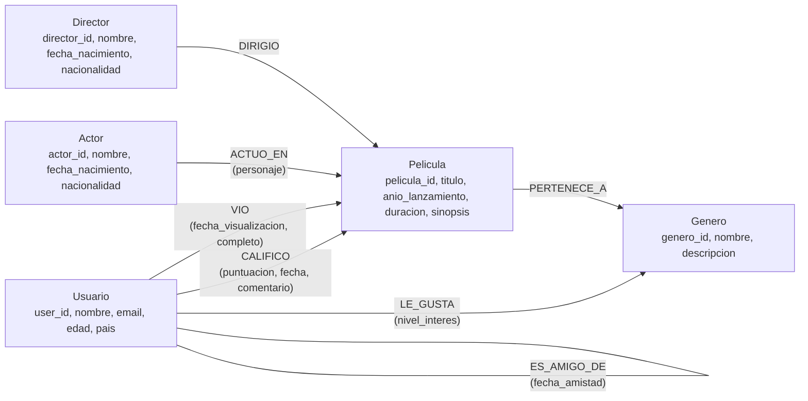

# Diagrama de Grafo Final

Este diagrama resume el modelo conceptual/fisico implementado para el sistema de recomendacion de peliculas en Neo4j.

## Reglas clave reflejadas
- `CALIFICO.puntuacion` en rango de 1 a 5.
- La amistad se consulta como relacion bidireccional en Cypher.
- Una pelicula puede tener varios actores y generos, y un director.

## Trazabilidad con scripts
- Esquema: `scripts/01_schema.cypher`
- Carga: `scripts/02_load_data.cypher`
- Consultas: `consultas/consultas_obligatorias.cypher`
