# Documentacion Tecnica - Segundo Proyecto BD2

## 1. Descripcion general
Este proyecto implementa un sistema de recomendacion de peliculas con Neo4j, modelando entidades y relaciones sociales para explotar consultas de grafos.

## 2. Modelo conceptual de grafo
### Nodos
- Usuario: `user_id`, `nombre`, `email`, `edad`, `pais`
- Pelicula: `pelicula_id`, `titulo`, `anio_lanzamiento`, `duracion`, `sinopsis`
- Genero: `genero_id`, `nombre`, `descripcion`
- Actor: `actor_id`, `nombre`, `fecha_nacimiento`, `nacionalidad`
- Director: `director_id`, `nombre`, `fecha_nacimiento`, `nacionalidad`

### Relaciones
- `(:Usuario)-[:CALIFICO {puntuacion, fecha, comentario}]->(:Pelicula)`
- `(:Usuario)-[:VIO {fecha_visualizacion, completo}]->(:Pelicula)`
- `(:Usuario)-[:ES_AMIGO_DE {fecha_amistad}]-(:Usuario)`
- `(:Pelicula)-[:PERTENECE_A]->(:Genero)`
- `(:Actor)-[:ACTUO_EN {personaje}]->(:Pelicula)`
- `(:Director)-[:DIRIGIO]->(:Pelicula)`
- `(:Usuario)-[:LE_GUSTA {nivel_interes}]->(:Genero)`

## 3. Reglas de negocio reflejadas
- Rango de calificacion de 1 a 5 (controlado en la generacion de datos).
- Amistad tratada como bidireccional en consultas usando patron sin direccion.
- Evita duplicados por IDs unicos y uso de `MERGE`.

## 4. Scripts implementados
- `scripts/01_schema.cypher`: constraints e indices.
- `scripts/02_load_data.cypher`: carga de nodos y relaciones con `LOAD CSV`.
- `scripts/generar_csv.py`: genera data minima requerida.

### 4.1 Script Cypher completo de creacion del esquema
```cypher
CREATE CONSTRAINT usuario_id_unique IF NOT EXISTS
FOR (u:Usuario)
REQUIRE u.user_id IS UNIQUE;

CREATE CONSTRAINT pelicula_id_unique IF NOT EXISTS
FOR (p:Pelicula)
REQUIRE p.pelicula_id IS UNIQUE;

CREATE CONSTRAINT genero_id_unique IF NOT EXISTS
FOR (g:Genero)
REQUIRE g.genero_id IS UNIQUE;

CREATE CONSTRAINT actor_id_unique IF NOT EXISTS
FOR (a:Actor)
REQUIRE a.actor_id IS UNIQUE;

CREATE CONSTRAINT director_id_unique IF NOT EXISTS
FOR (d:Director)
REQUIRE d.director_id IS UNIQUE;

CREATE INDEX pelicula_titulo_idx IF NOT EXISTS
FOR (p:Pelicula)
ON (p.titulo);

CREATE INDEX genero_nombre_idx IF NOT EXISTS
FOR (g:Genero)
ON (g.nombre);

CREATE INDEX usuario_email_idx IF NOT EXISTS
FOR (u:Usuario)
ON (u.email);
```

## 5. Consultas y analisis
Archivo: `consultas/consultas_obligatorias.cypher`
- Consultas de negocio obligatorias.
- Consulta de recomendacion por amigos + gustos.
- Analisis de grados de separacion.
- Analisis de peliculas altamente conectadas.

## 6. Evidencia visual tecnica
### 6.0 Diagrama conceptual del modelo (mockup requerido)
Esta evidencia corresponde al entregable de mockups/disenos del enunciado.

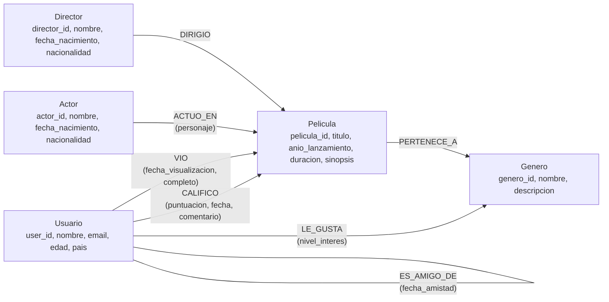
Descripcion: diagrama visual del modelo con todos los tipos de nodos, relaciones con direccion y propiedades clave.

### 6.1 Preparacion de entorno
Instancia en ejecucion y carpeta import con archivos CSV cargados.

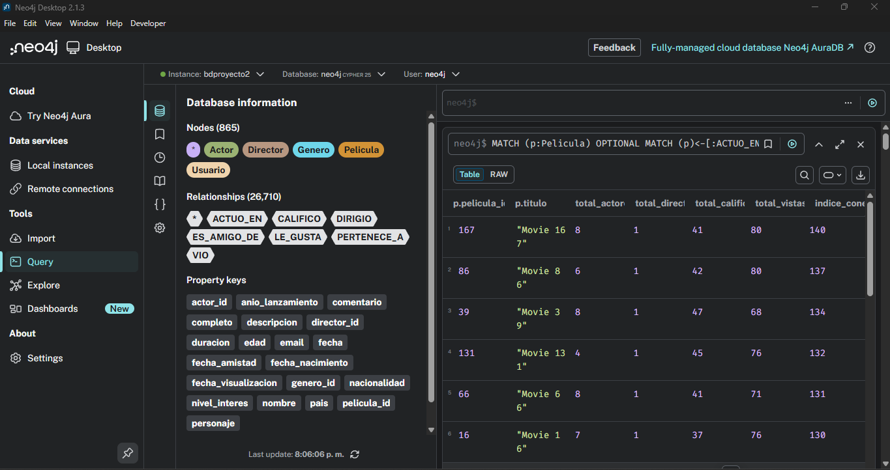
Descripcion: confirma que el DBMS local se encuentra activo y listo para pruebas.

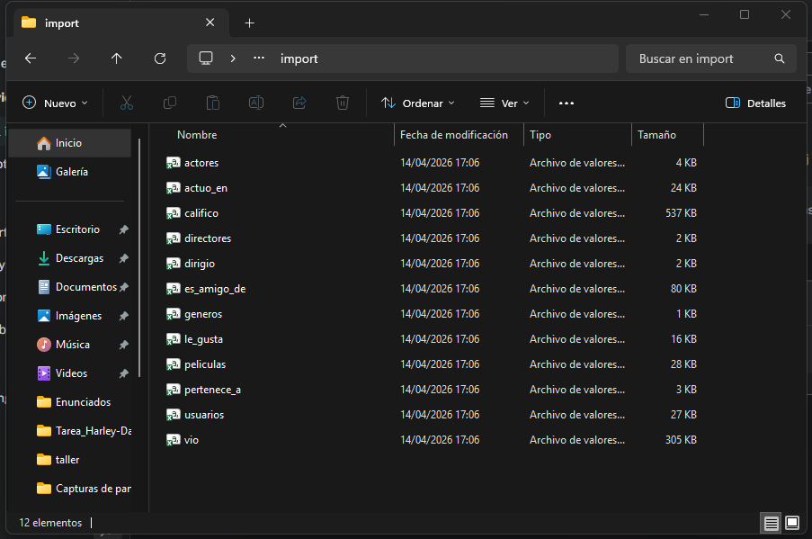
Descripcion: evidencia que los archivos fuente estan disponibles para carga masiva.

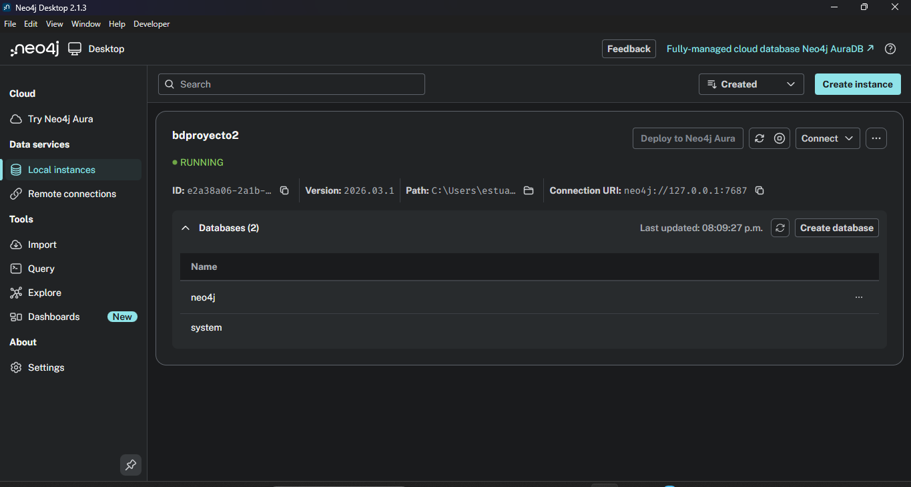
Descripcion: confirma conexion operativa a la base neo4j para ejecutar Cypher.

### 6.2 Implementacion fisica
Ejecucion del esquema y carga masiva con validacion por conteos.

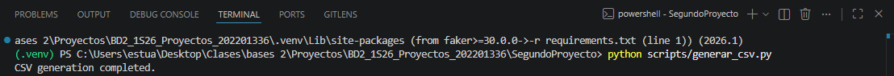
Descripcion: evidencia de creacion de restricciones e indices del modelo.

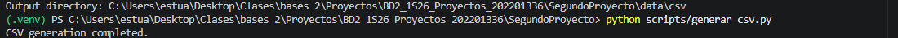
Descripcion: evidencia de insercion de nodos y relaciones via LOAD CSV.

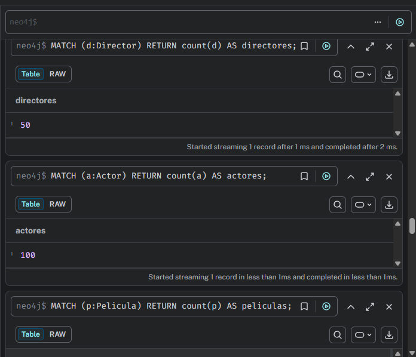
Descripcion: validacion de cantidades minimas exigidas por el proyecto.

### 6.3 Evidencia de consultas de negocio
Resultados representativos de consultas obligatorias.

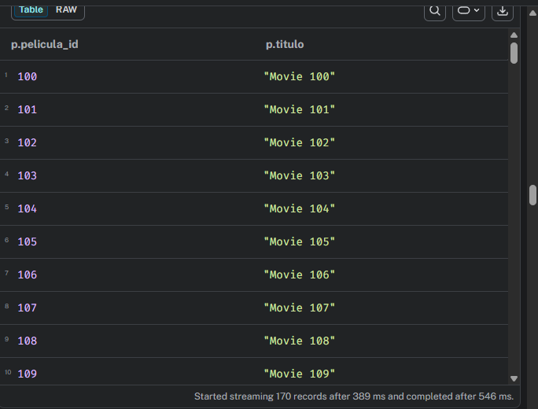
Descripcion: peliculas con puntuacion mayor a 4 para el usuario de referencia.

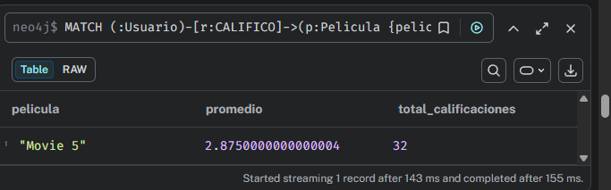
Descripcion: peliculas vistas por amigos que aun no figuran en el historial del usuario.

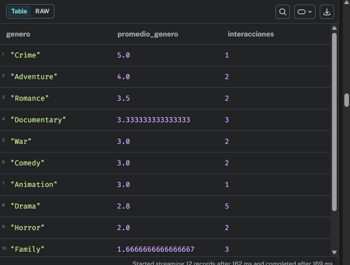
Descripcion: promedio de calificacion y numero de votos de una pelicula.

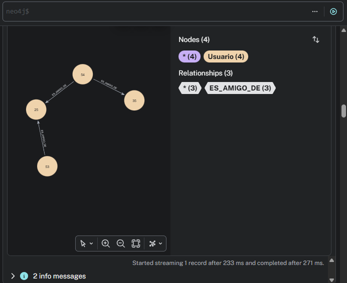
Descripcion: identificacion de generos favoritos por comportamiento de calificacion.

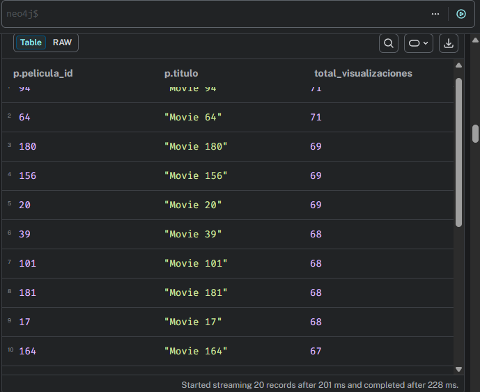
Descripcion: resultado del camino minimo de amistad entre dos usuarios.

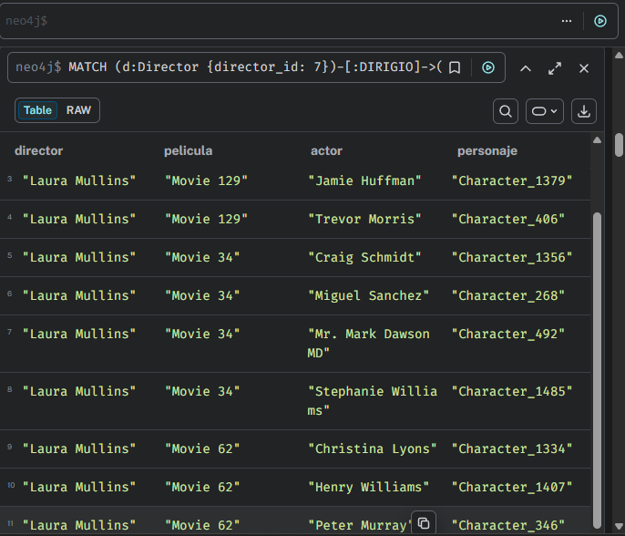
Descripcion: ranking de peliculas mas vistas para el genero consultado.

### 6.4 Evidencia de recomendacion y analisis de red
Consultas de recomendacion y analitica del grafo.

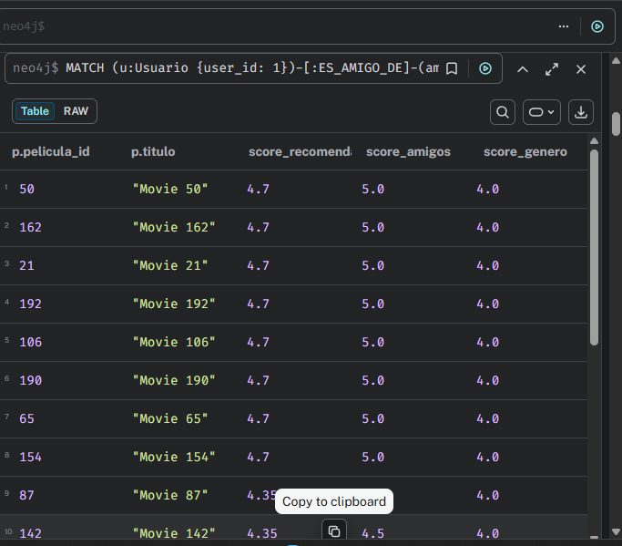
Descripcion: relacion director-pelicula-actor como evidencia de traversal multihop.

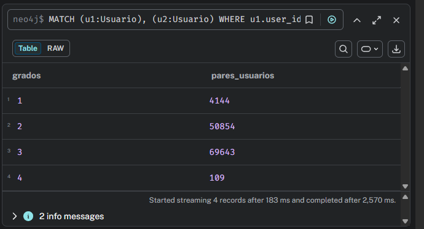
Descripcion: top de recomendaciones calculadas con score social y de preferencia.

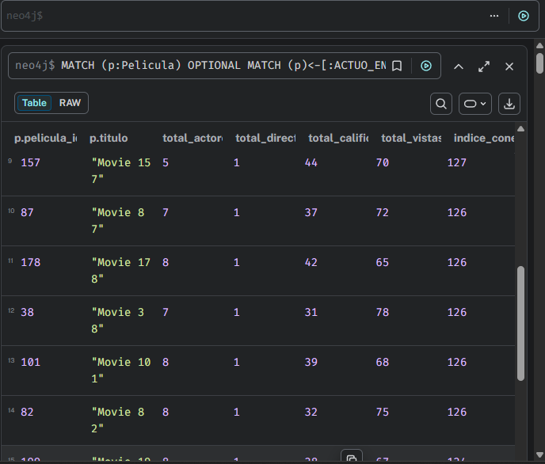
Descripcion: distribucion de grados de separacion de la red de usuarios.

## 7. Analisis de ventajas de usar Neo4j
- Neo4j modela de forma natural relaciones complejas entre usuarios, peliculas y red social sin necesidad de joins costosos.
- El lenguaje Cypher facilita expresar recorridos multihop (amistades, gustos y visualizaciones) de manera legible.
- Consultas de recomendacion y analisis de conectividad se implementan con menor complejidad que en modelos relacionales tradicionales.
- `shortestPath` permite resolver de forma directa grados de separacion entre usuarios.
- El enfoque de grafo favorece evolucion del modelo para agregar nuevas relaciones sin redisenar un esquema tabular rigido.

