# Manual de Usuario - Segundo Proyecto BD2

## 1. Objetivo
Este manual describe el flujo completo para ejecutar el proyecto en Neo4j, validar resultados y documentar evidencias para entrega.

## 2. Requisitos previos
- Neo4j Desktop o Neo4j Community 5.x.
- Python 3.10 o superior.
- Carpeta de trabajo: `SegundoProyecto`.

Archivos base del proyecto:
- `scripts/01_schema.cypher`
- `scripts/02_load_data.cypher`
- `scripts/generar_csv.py`
- `consultas/consultas_obligatorias.cypher`
- `docs/Plantilla_Evidencias.md`

## 3. Flujo operativo recomendado
### Paso 1. Generar datos CSV
Ejecutar en terminal dentro de `SegundoProyecto`:

```bash
pip install -r requirements.txt
python scripts/generar_csv.py
```

Salida esperada: mensaje `CSV generation completed` y archivos en `data/csv`.

Nota: esta ejecucion puede documentarse en la captura de carga de datos de la plantilla de evidencias.


### Paso 2. Cargar archivos al DBMS
1. Abrir Neo4j Desktop y verificar instancia en estado RUNNING.
2. Abrir la carpeta del DBMS desde el icono de carpeta junto a `Path`.
3. Entrar a la carpeta `import`.
4. Copiar todos los CSV desde `data/csv` a `import`.

Capturas sugeridas:
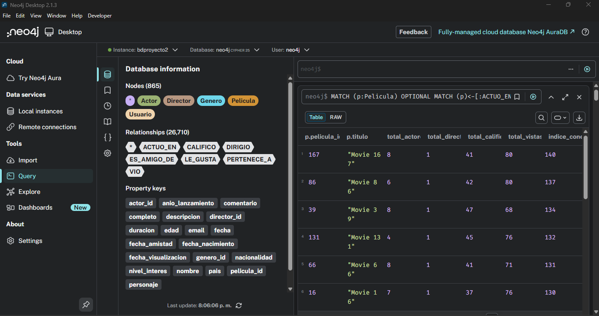
Descripcion: estado RUNNING de la instancia local en Neo4j Desktop.

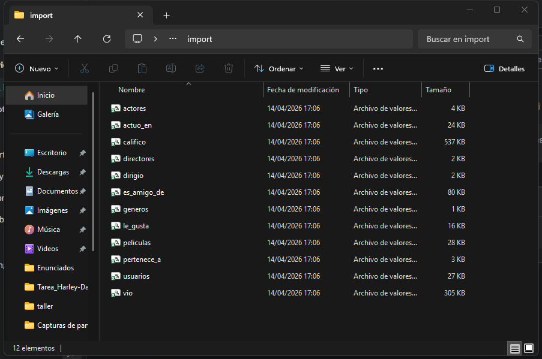
Descripcion: carpeta import con los CSV listos para ser leidos por LOAD CSV.

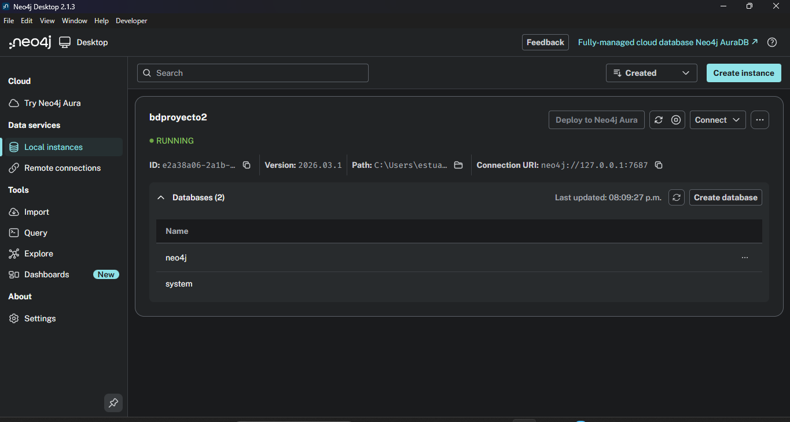
Descripcion: sesion de Query conectada a la base neo4j.

### Paso 3. Ejecutar esquema y carga
En Neo4j Query ejecutar en orden:
1. Todo `scripts/01_schema.cypher`.
2. Todo `scripts/02_load_data.cypher`.

Capturas sugeridas:
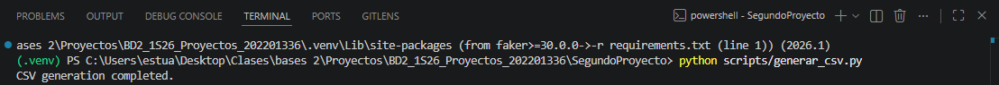
Descripcion: ejecucion correcta del script de esquema (constraints e indices).

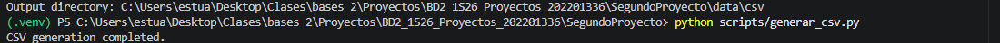
Descripcion: ejecucion correcta de la carga masiva de nodos y relaciones.

### Paso 4. Validar conteos minimos
Ejecutar:

```cypher
MATCH (u:Usuario) RETURN count(u) AS usuarios;
MATCH (p:Pelicula) RETURN count(p) AS peliculas;
MATCH (a:Actor) RETURN count(a) AS actores;
MATCH (d:Director) RETURN count(d) AS directores;
MATCH (g:Genero) RETURN count(g) AS generos;
```

Minimos esperados:
- usuarios >= 500
- peliculas >= 200
- actores >= 100
- directores >= 50
- generos >= 15

Captura sugerida:
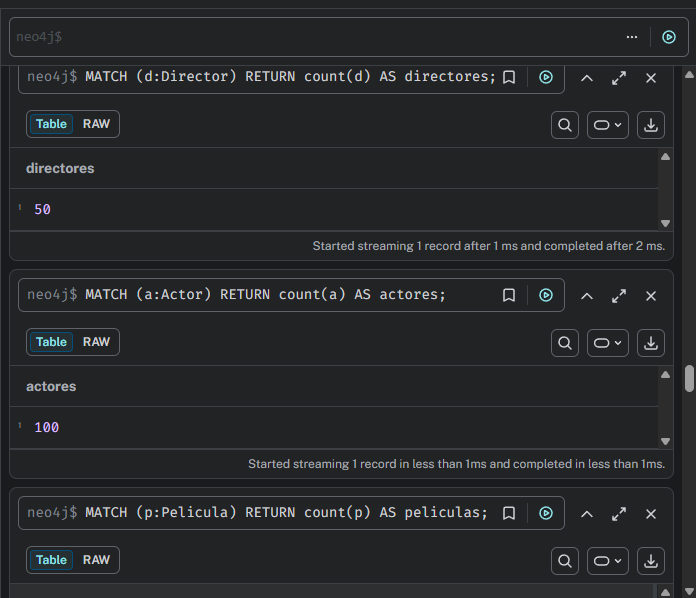
Descripcion: verificacion de cantidades minimas requeridas por el enunciado.

### Paso 5. Ejecutar consultas funcionales
Abrir `consultas/consultas_obligatorias.cypher` y ejecutar bloques en este orden:
1. Q1
2. Q2
3. Q3
4. Q4
5. Q5
6. Q6
7. Q7
8. Q8
9. Analysis 1
10. Analysis 2

Capturas sugeridas por bloque:
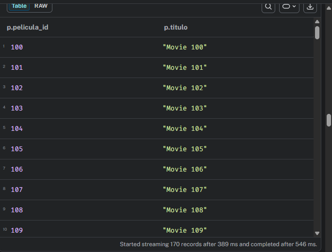
Descripcion: peliculas calificadas por el usuario con puntuacion mayor a 4.

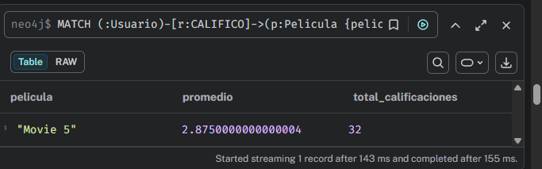
Descripcion: peliculas vistas por amigos que el usuario aun no ha visto.

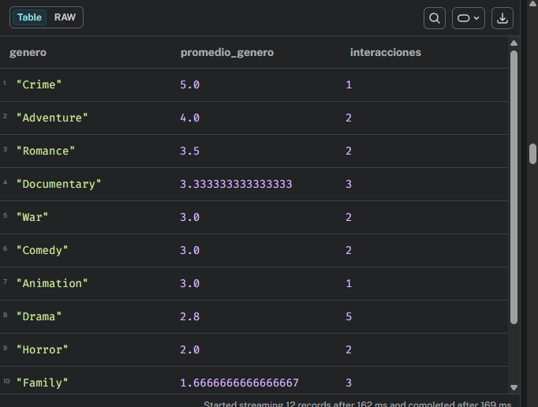
Descripcion: promedio y cantidad de calificaciones de una pelicula.

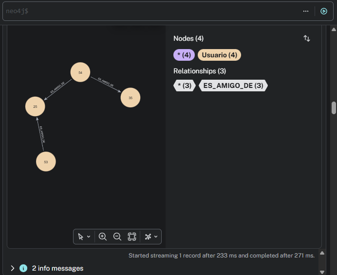
Descripcion: generos favoritos del usuario segun historial de calificaciones.

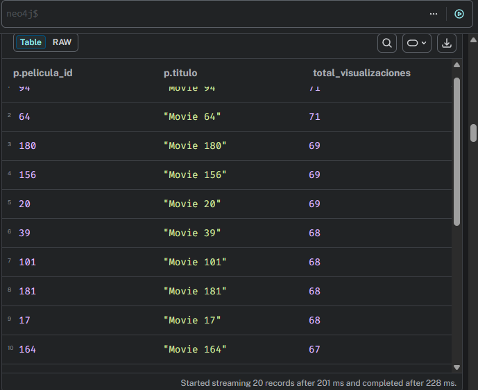
Descripcion: ruta mas corta de amistad entre dos usuarios.

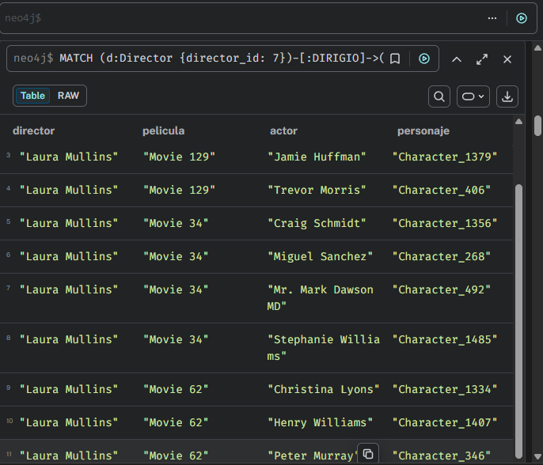
Descripcion: ranking de peliculas mas populares dentro de un genero.

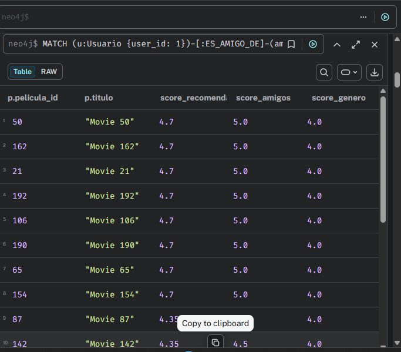
Descripcion: actores asociados a peliculas dirigidas por un director especifico.

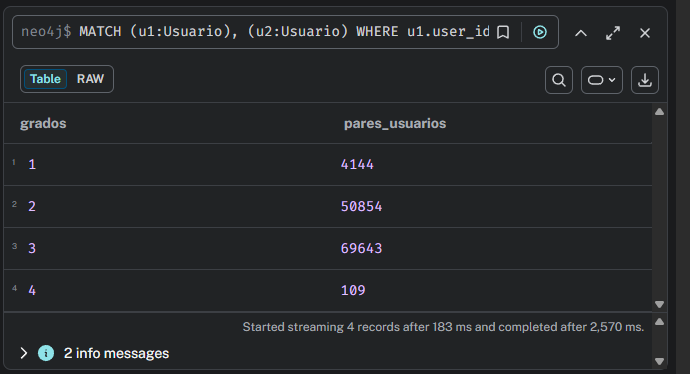
Descripcion: recomendaciones calculadas por calificaciones de amigos y gustos del usuario.

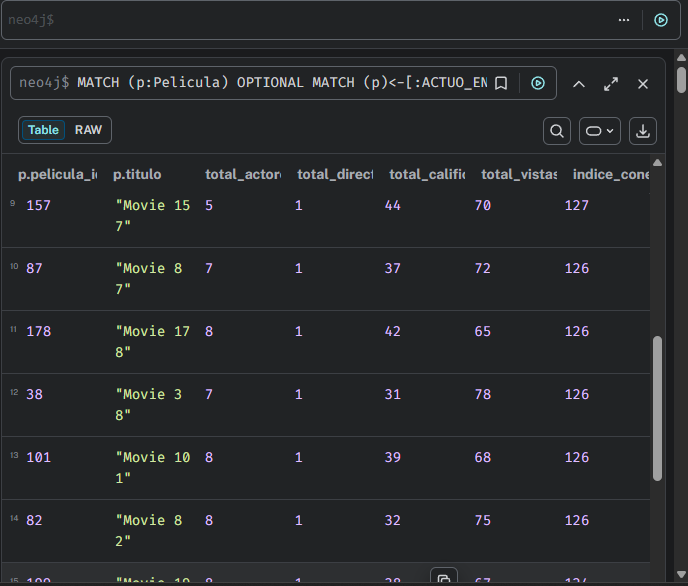
Descripcion: distribucion de grados de separacion en la red de amistades.

### Interpretacion de resultados de recomendacion (Q8)
- `score_amigos`: promedio de calificaciones altas dadas por amigos a una pelicula no vista por el usuario.
- `score_genero`: afinidad del usuario con los generos de esa pelicula, segun relaciones `LE_GUSTA`.
- `score_recomendacion`: combinacion ponderada (70% social y 30% preferencias) para priorizar sugerencias.
- Lectura practica: entre mayor sea `score_recomendacion`, mayor prioridad tiene la pelicula para recomendarse al usuario.


## 4. Seccion de galeria final en el informe
Al exportar a PDF, mantener esta secuencia visual:
1. Configuracion y preparacion (E01-E03).
2. Implementacion fisica y validacion (E05-E07).
3. Consultas de negocio (E08-E13).
4. Consultas complementarias y recomendacion (E14-E15).
5. Analisis de red (E16).

## 5. Solucion de problemas frecuente
- Error `Couldn't load the external resource`:
  - Verificar que el CSV exista en `import` y con el mismo nombre.
  - Verificar permisos de lectura de la carpeta.
- Error de datos no encontrados:
  - Ejecutar primero `01_schema.cypher` y luego `02_load_data.cypher`.
- Lotes lentos:
  - Ejecutar bloques por separado y esperar confirmacion antes del siguiente.


