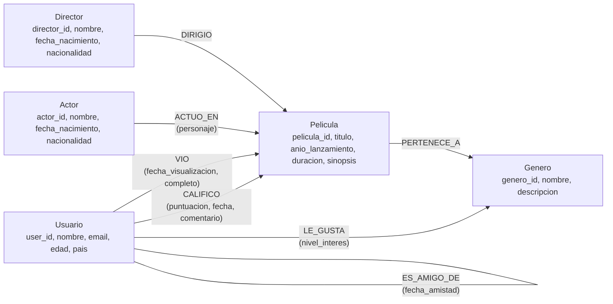

# Mockups y Disenos del Grafo

## 1. Diagrama conceptual del modelo
El diagrama conceptual del modelo se encuentra en:
- `docs/Diagrama_Grafo_Final.md`

Captura del diagrama para evidencia visual:



Descripcion: representacion del modelo completo con nodos `Usuario`, `Pelicula`, `Genero`, `Actor`, `Director` y relaciones `CALIFICO`, `VIO`, `ES_AMIGO_DE`, `PERTENECE_A`, `ACTUO_EN`, `DIRIGIO`, `LE_GUSTA`.

Este diagrama cubre:
- Tipos de nodos requeridos.
- Relaciones requeridas con direccion.
- Propiedades clave de nodos y relaciones.

## 2. Ejemplo de instancia real del grafo (obligatorio para entregable)
Para cumplir la parte de "ejemplos de instancias del grafo con datos reales", ejecutar en Neo4j Query:

```cypher
MATCH p = (u:Usuario {user_id: 1})-[:ES_AMIGO_DE]-(amigo:Usuario)-[:VIO]->(pel:Pelicula)
RETURN p
LIMIT 30;
```

Captura requerida:
- Archivo sugerido: `docs/evidencias/capturas/17_instancia_grafo_real.png`.
- Debe verse: nodos `Usuario` conectados por `ES_AMIGO_DE` y nodos `Pelicula` conectados por `VIO`.
- Importante: esta evidencia debe tomarse en vista Graph (no tabla) para mostrar una instancia real conectada.
- Interpretacion sugerida: el grafo evidencia traversal social y de consumo para recomendaciones.

## 3. Visualizacion adicional recomendada
Consulta opcional para instancia rica (amistad + calificacion + genero):

```cypher
MATCH p = (u:Usuario {user_id: 1})-[c:CALIFICO]->(pel:Pelicula)-[:PERTENECE_A]->(g:Genero)
RETURN p
LIMIT 25;
```

Esta captura fortalece la documentacion del flujo de recomendacion basado en preferencias.
