# Plantilla de Evidencias - Segundo Proyecto BD2

## 1. Datos generales
- Curso: Sistemas de Bases de Datos 2
- Proyecto: Sistema de Recomendacion de Peliculas con Neo4j
- Estudiante: Estuardo
- Carnet: 202201336
- Fecha de entrega: 2026-04-15
- Version Neo4j: 2026.03.1
- Entorno: Desktop

## 2. Estructura de almacenamiento de evidencia
Ruta sugerida para imagenes:
- `docs/evidencias/capturas/`

## 3. Evidencia de configuracion y preparacion
### E01 - Instancia activa
Significado: confirma que el DBMS esta iniciado y listo para ejecutar consultas.

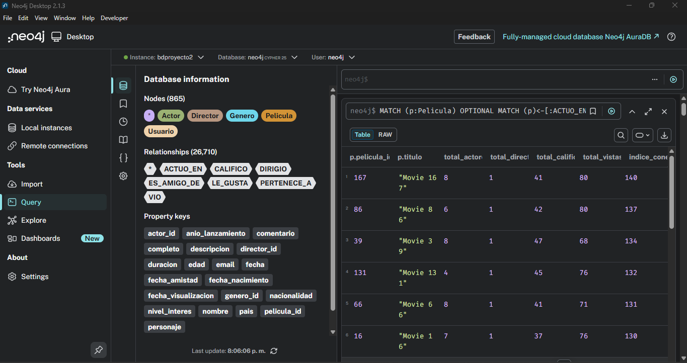

### E02 - Carpeta import con archivos CSV
Significado: confirma que `LOAD CSV` puede acceder a los insumos de datos.

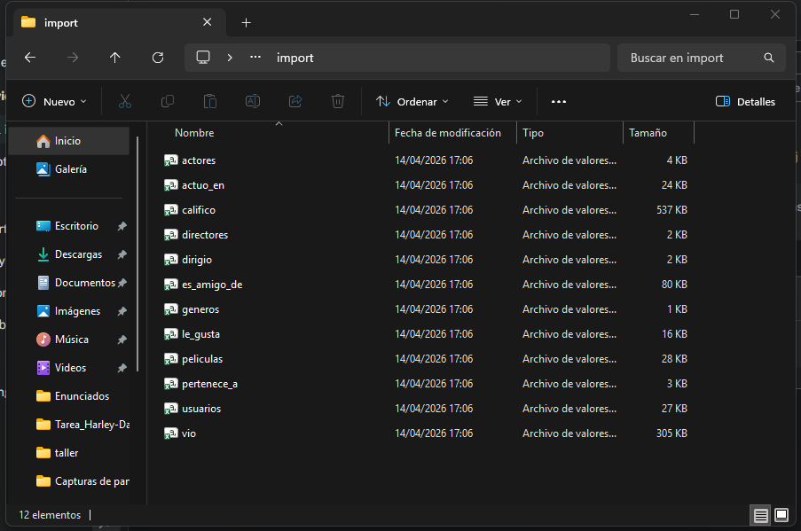

### E03 - Sesion Query conectada
Significado: confirma conexion operativa a la base `neo4j`.

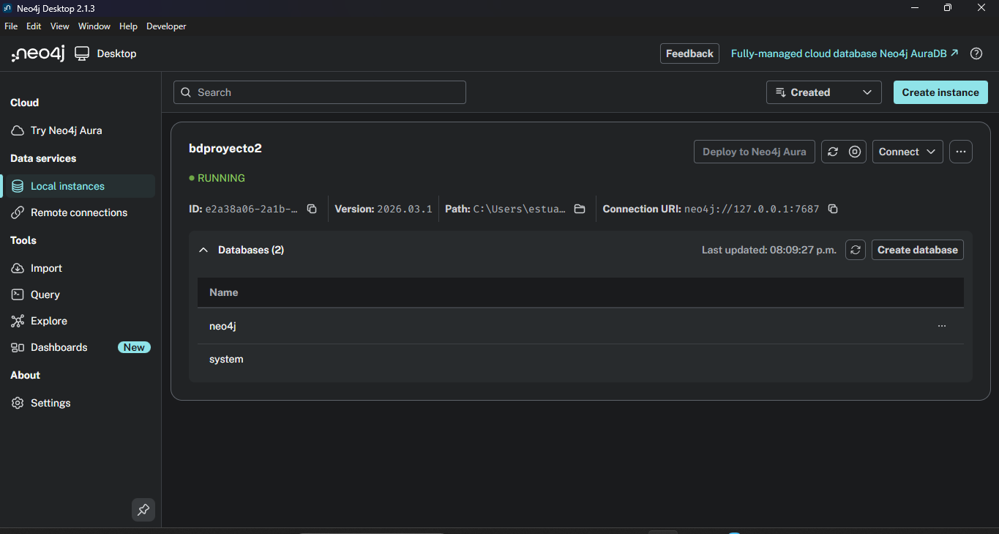

## 4. Evidencia de implementacion fisica
### E05 - Esquema ejecutado
Significado: confirma creacion de constraints e indices.

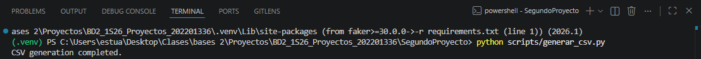

### E06 - Carga masiva ejecutada
Significado: confirma insercion de nodos y relaciones.

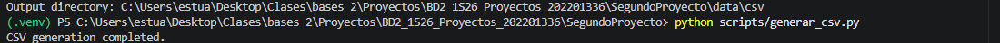

### E07 - Conteos minimos
Significado: confirma cumplimiento de volumen minimo del enunciado.

Consultas usadas:
```cypher
MATCH (u:Usuario) RETURN count(u) AS usuarios;
MATCH (p:Pelicula) RETURN count(p) AS peliculas;
MATCH (a:Actor) RETURN count(a) AS actores;
MATCH (d:Director) RETURN count(d) AS directores;
MATCH (g:Genero) RETURN count(g) AS generos;
```

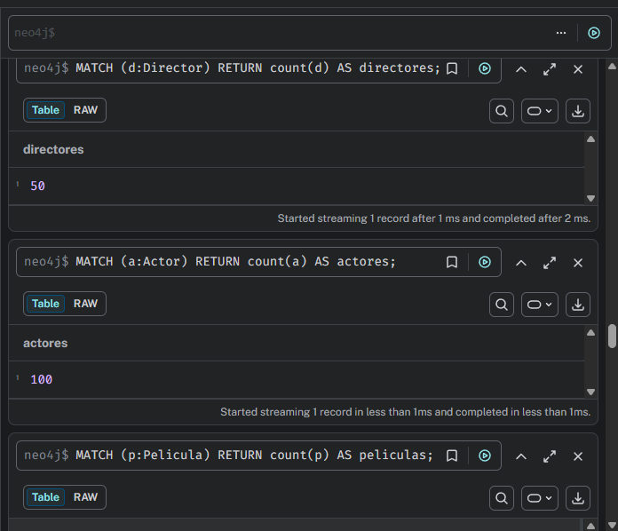

Interpretacion:
- Los resultados de conteo evidencian que el volumen de datos cargado cumple con los minimos exigidos por el enunciado (500 usuarios, 200 peliculas, 100 actores, 50 directores y 15 generos). Esto confirma que la base esta preparada para ejecutar consultas de negocio y analisis de red sobre un conjunto representativo.

## 5. Evidencia de consultas de negocio (obligatorias + adicionales)
Consultas obligatorias segun rubrica: Q1, Q2, Q4, Q5, Q7 y Q8.
Consultas adicionales implementadas: Q3 y Q6.

### E08 - Q1 Peliculas calificadas > 4
Significado: valida preferencia positiva por puntuacion alta.

Query usada:
```cypher
MATCH (u:Usuario {user_id: 1})-[r:CALIFICO]->(p:Pelicula)
WHERE r.puntuacion > 4
RETURN p.pelicula_id, p.titulo, r.puntuacion, r.fecha
ORDER BY r.puntuacion DESC, r.fecha DESC;
```

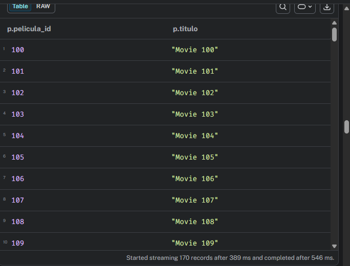

Interpretacion:
- La consulta devuelve peliculas que el usuario ha valorado con puntuaciones altas, lo cual permite identificar preferencias explicitas de contenido. Este resultado es util para perfilar gustos y servir como base para recomendaciones personalizadas.

### E09 - Q2 Peliculas vistas por amigos no vistas por usuario
Significado: valida base social de recomendacion.

Query usada:
```cypher
MATCH (u:Usuario {user_id: 1})-[:ES_AMIGO_DE]-(amigo:Usuario)-[:VIO]->(p:Pelicula)
WHERE NOT (u)-[:VIO]->(p)
RETURN DISTINCT p.pelicula_id, p.titulo
ORDER BY p.titulo;
```

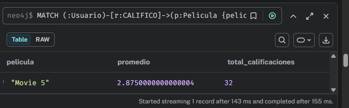

Interpretacion:
- El resultado muestra contenido consumido por la red social inmediata del usuario que aun no aparece en su historial de visualizacion. Esta salida valida el enfoque de recomendacion social basado en amistades y reduce recomendaciones redundantes.

### E10 - Q3 Promedio de calificaciones de pelicula (adicional)
Significado: valida metrica agregada de valoracion por contenido.

Query usada:
```cypher
MATCH (:Usuario)-[r:CALIFICO]->(p:Pelicula {pelicula_id: 5})
RETURN p.titulo AS pelicula, avg(r.puntuacion) AS promedio, count(r) AS total_calificaciones;
```

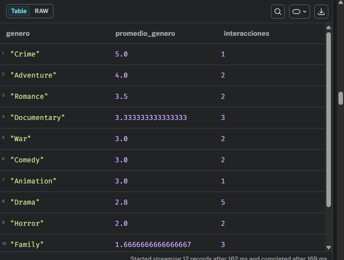

Interpretacion:
- La metrica de promedio de calificaciones resume la percepcion global de una pelicula dentro de la plataforma. Junto con el total de calificaciones, permite evaluar estabilidad de la valoracion y priorizar contenidos mejor evaluados.

### E11 - Q4 Generos favoritos por historial
Significado: valida perfil de gustos por comportamiento real.

Query usada:
```cypher
MATCH (u:Usuario {user_id: 1})-[r:CALIFICO]->(p:Pelicula)-[:PERTENECE_A]->(g:Genero)
RETURN g.nombre AS genero, avg(r.puntuacion) AS promedio_genero, count(*) AS interacciones
ORDER BY promedio_genero DESC, interacciones DESC;
```

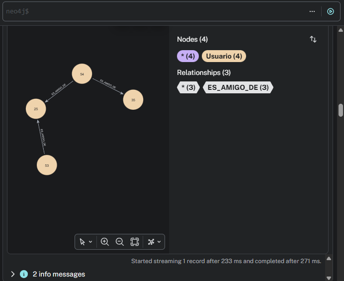

Interpretacion:
- La salida ordenada por promedio e interacciones identifica los generos con mejor respuesta del usuario segun su propio comportamiento. Esto confirma que el modelo captura afinidad tematica y permite ajustar recomendaciones por preferencias reales.

### E12 - Q5 Ruta mas corta entre usuarios
Significado: valida calculo de grados de separacion.

Query usada:
```cypher
MATCH (u1:Usuario {user_id: 10}), (u2:Usuario {user_id: 33})
MATCH p = shortestPath((u1)-[:ES_AMIGO_DE*]-(u2))
RETURN p, length(p) AS grados_separacion;
```

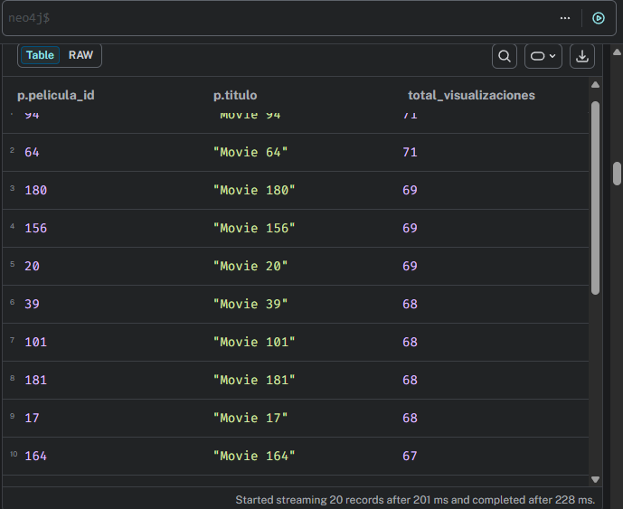

Interpretacion:
- La consulta confirma que existe conectividad entre los usuarios evaluados y calcula sus grados de separacion mediante `shortestPath`. Este resultado valida el uso de grafos para medir proximidad social y soportar recomendaciones por cercania en la red.

### E13 - Q6 Peliculas mas populares por genero (adicional)
Significado: valida tendencia por volumen de visualizaciones.

Query usada:
```cypher
MATCH (:Usuario)-[:VIO]->(p:Pelicula)-[:PERTENECE_A]->(g:Genero {nombre: 'Action'})
RETURN p.pelicula_id, p.titulo, count(*) AS total_visualizaciones
ORDER BY total_visualizaciones DESC
LIMIT 20;
```

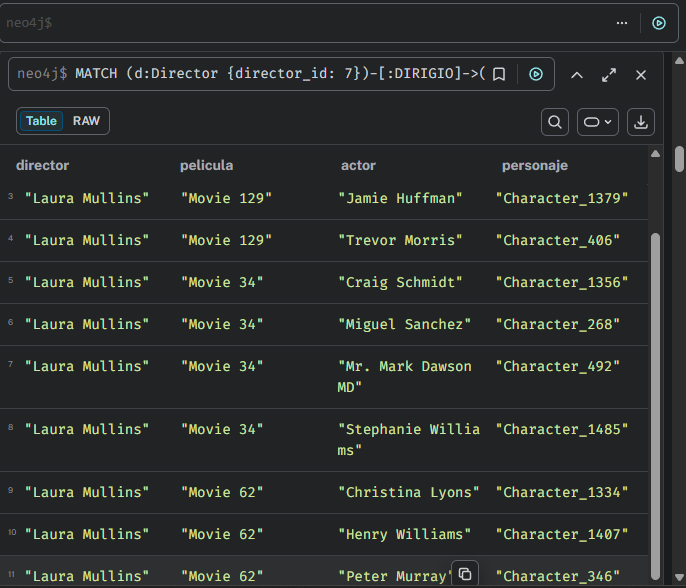

Interpretacion:
- El ranking obtenido refleja las peliculas con mayor volumen de visualizaciones dentro del genero consultado. Esta informacion es util para detectar tendencias de consumo y priorizar sugerencias populares por categoria.

## 6. Evidencia de consultas obligatorias restantes (rubrica)
### E14 - Q7 Actores por director
Significado: valida traversal entre direccion y reparto.

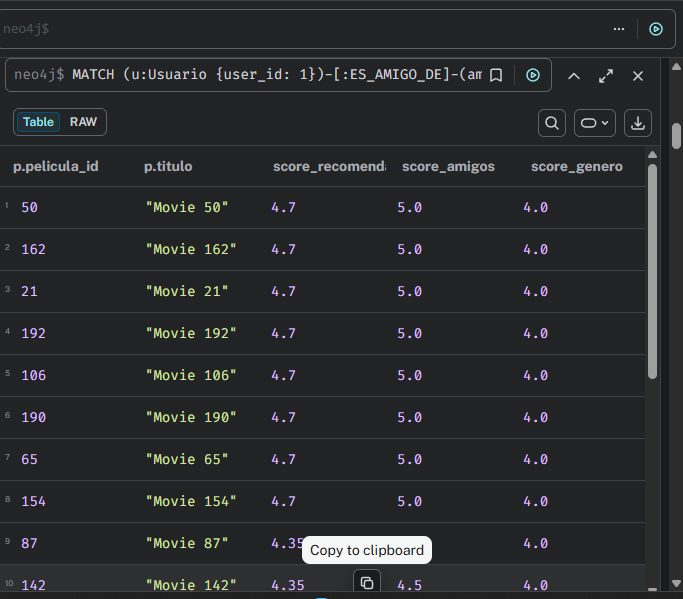

Interpretacion:
- La consulta evidencia correctamente la relacion entre direccion y reparto para cada pelicula, demostrando traversal multihop entre nodos `Director`, `Pelicula` y `Actor`. Esto confirma que el modelo representa relaciones complejas de produccion cinematografica.

### E15 - Q8 Recomendacion por amigos y gustos
Significado: valida puntaje compuesto de recomendacion.

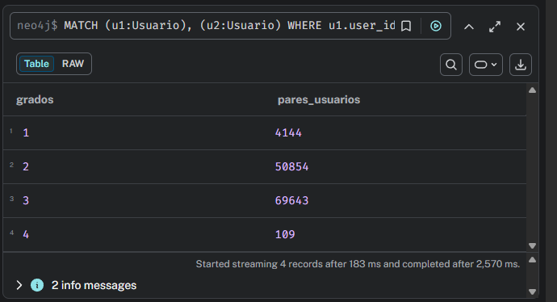

Interpretacion:
- El score compuesto combina calificaciones positivas de amigos y afinidad por genero del usuario, generando una lista priorizada de recomendaciones. La salida valida una estrategia de recomendacion hibrida social + preferencia que aprovecha las relaciones del grafo.

## 7. Evidencia de analisis de red
### E16 - Analysis 1 Distribucion de grados
Significado: cuantifica conectividad social de la red.

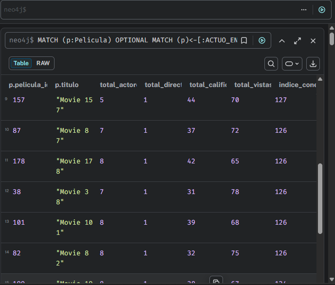

Interpretacion:
- La distribucion de grados muestra el nivel de conectividad global de la red de amistades y permite identificar cuan separadas o cercanas estan las personas en la plataforma. Esta metrica confirma que la estructura social es explotable para recomendaciones transitivas.

## 8. Evidencia de instancia real del grafo para Mockups
### E17 - Instancia real visual del grafo (vista Graph)
Significado: cumple el requisito de mostrar ejemplos de instancias del grafo con datos reales en formato visual de nodos y relaciones.

Query usada:
```cypher
MATCH p = (u:Usuario {user_id: 1})-[:ES_AMIGO_DE]-(amigo:Usuario)-[:VIO]->(pel:Pelicula)
RETURN p
LIMIT 30;
```

Captura sugerida:
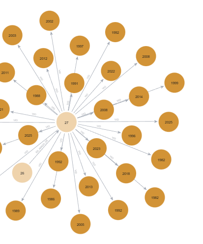

Interpretacion:
- La visualizacion confirma que el modelo no solo devuelve tablas, sino tambien estructura conectada real entre usuarios, amistades y consumo de peliculas.


## 9. Conclusiones finales
- Ventajas observadas al usar Neo4j: Neo4j permite modelar relaciones complejas de forma natural y consultar recorridos multihop con expresividad y buen desempeno. Consultas como rutas cortas, recomendaciones por red social y analisis de conectividad se implementan de manera directa y legible en Cypher.
- Limitaciones encontradas: La carga y validacion inicial requieren cuidado en la consistencia de CSV, tipos de datos y orden de ejecucion de scripts. Adicionalmente, el rendimiento puede verse afectado en consultas amplias si no se aplican indices adecuados o filtros tempranos.
- Mejoras futuras: Como evolucion del prototipo se recomienda incorporar deteccion de comunidades, centralidad de usuarios influyentes y filtrado colaborativo avanzado. Tambien es conveniente parametrizar consultas, ajustar pesos del score de recomendacion con evaluacion empirica y automatizar reportes de evidencia.
